# Modern Redmine Theme — Redmine 7

A clean, modern UI theme for **Redmine 7** with dark mode, 27 colour schemes (plus any of
~1,250 Gogh palettes), a sidebar on the left or right, and design tokens.

> This is the `redmine-7` branch, written from scratch for Redmine 7.
> For Redmine 6 use the [`main`](https://github.com/acosonic/redmine-modern-theme/tree/main) branch.

| Light | Dark |
|---|---|
| 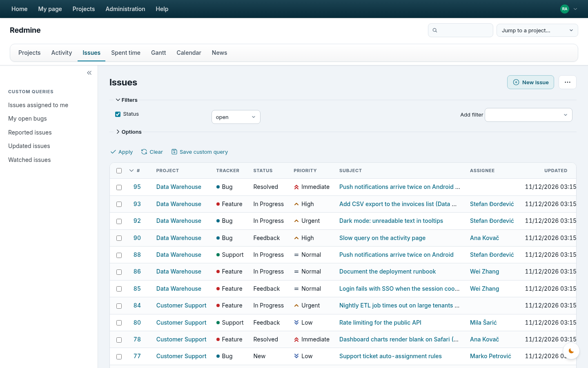 | 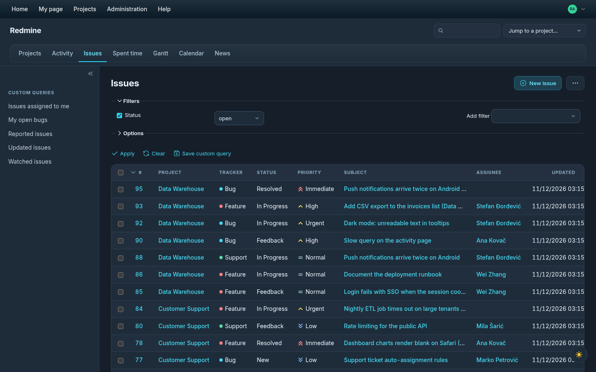 |
| 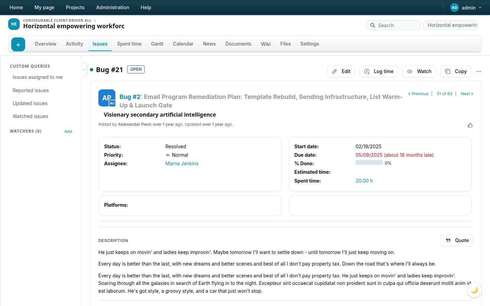 | 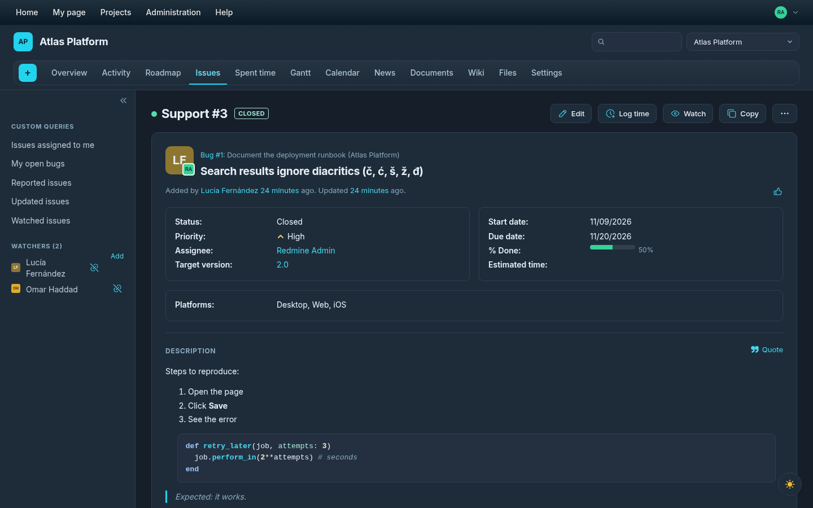 |

More screenshots are in the [gallery](#screenshots) below.

## How it is built

Redmine 7 changed what a theme can lean on, and this branch is built around that:

- **Core's stylesheet sits in a cascade layer.** `application.css` starts with
  `@import url(/application.css) layer(core)`. Theme rules are unlayered, so they win over
  core whatever its specificity — the theme has **no `!important`** outside one short block
  that answers core's own `!important` rules. (The Redmine 6 branch needed 2,195 of them.)
- **Colours go through core's own variables.** Redmine 7 paints with the Open Color scale
  (`--oc-*`). The theme sets about a dozen inputs (`--rm-bg`, `--rm-fg`, `--rm-accent`, …)
  and re-derives that scale from them with `color-mix()`. Dark mode and every colour scheme
  are just different inputs; core, plugins that use `--oc-*`, and the theme all follow.
- **Core's own components are used, not replaced.** The account menu, the mobile flyout
  menu, the sidebar collapse button and the Gantt chart are Redmine 7's; the theme styles
  them. `theme.js` only adds what core has not got.

## Status

Beta. The core pages are done and contrast-checked (WCAG AA) in light, dark and all 27
schemes. Plugin-specific styling from the Redmine 6 theme has not been ported yet, and
some less-used pages (repository browser, roadmap, wiki history, admin tables) have only
had the general treatment. Reports and screenshots are welcome in the
[issues](https://github.com/acosonic/redmine-modern-theme/issues).

## Features

- Light / dark mode: follows the operating system until you choose, then remembered per
  browser, with no flash on load. It also remembers your colour scheme for each mode.
- 27 colour schemes from [Gogh](https://github.com/Gogh-Co/Gogh) — Dracula, Nord, Gruvbox,
  Catppuccin, Rosé Pine, Tokyo Night, Solarized Light, GitHub and more — each
  contrast-checked to WCAG AA. Pick one on **My account**; the four used last sit in the
  account menu. Or search **all ~1,250 Gogh palettes** by name and pick an accent.
- Sidebar on the left (default) or the right — choose on **My account**; collapse it with
  Redmine's own button.
- Sticky top bar, header and project tab bar on desktop; sticky sidebar that falls back to
  scrolling with the page when it is taller than the window.
- Priority arrows and a colour dot per tracker in issue lists and on the issue page.
- Syntax highlighting, Gantt bars and the calendar coloured from the active palette.
- Project list as a card grid that reads left to right.
- Collapsible Subtasks / Related issues sections, toast notifications
  (`window.rmToast(message, type, duration)`).
- Phones (below 900px): Redmine 7's own header and flyout menu in the theme's colours.
- Written with logical properties throughout, so right-to-left languages mirror as in core.
- Self-hosted Inter font, no external requests.

## Install

```bash
cd /path/to/redmine/themes
git clone -b redmine-7 https://github.com/acosonic/redmine-modern-theme
```

Restart Redmine (in production it recompiles assets on boot), then choose
**Administration → Settings → Display → Theme → Redmine modern theme**.

Updating: `git pull` in the theme folder and restart Redmine.

## Requirements

- Redmine **7.0** or later.
- A browser from 2024 or later: the theme relies on cascade layers, `color-mix()`,
  `light-dark()`, CSS nesting and `:has()` (Chrome/Edge 123+, Firefox 120+, Safari 17.5+).

## Customising

Change the palette by overriding the inputs at the top of `stylesheets/application.css`
(section 1) — for example in a custom stylesheet loaded after the theme:

```css
:root {
  --rm-accent: light-dark(#7C3AED, #A78BFA);
  --rm-topbar: light-dark(#2E1065, #1E1B4B);
}
```

Everything else — hover shades, tints, focus rings, the Open Color scale core uses — is
derived from those.

## Development

See [CLAUDE.md](CLAUDE.md) and [HANDOFF.md](HANDOFF.md). Tools live in `src/` (Redmine
does not publish that folder): `gen-schemes.py` builds the scheme blocks from Gogh,
`shot.mjs` takes screenshots and runs probes, `contrast.mjs` audits WCAG contrast,
`seed.rb` fills a local development database.

## Screenshots

All taken on Redmine 7.0.3 with the theme's test data.

**Light**

| Projects | Edit issue |
|---|---|
| 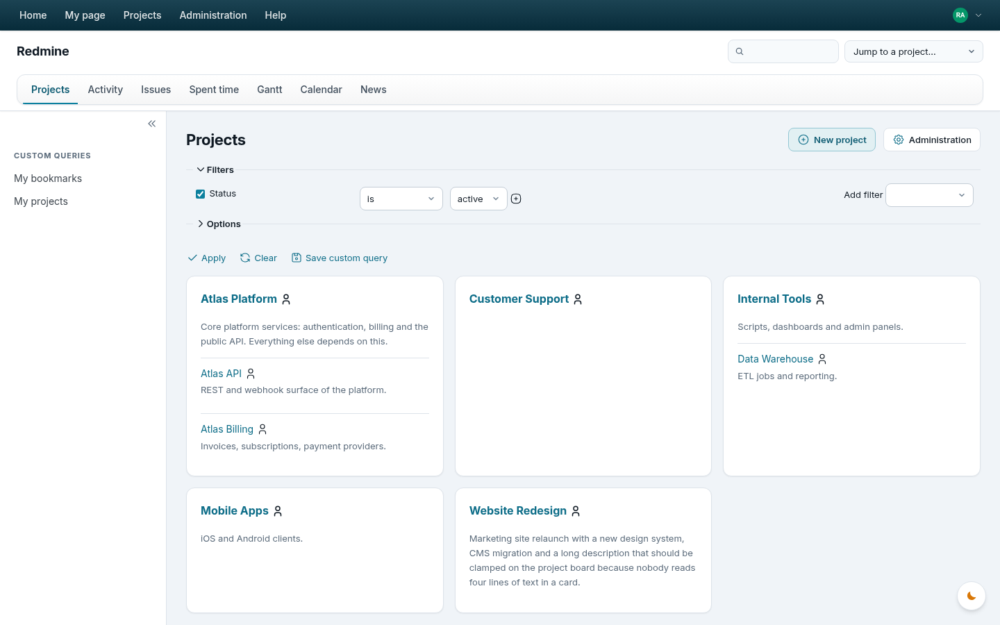 | 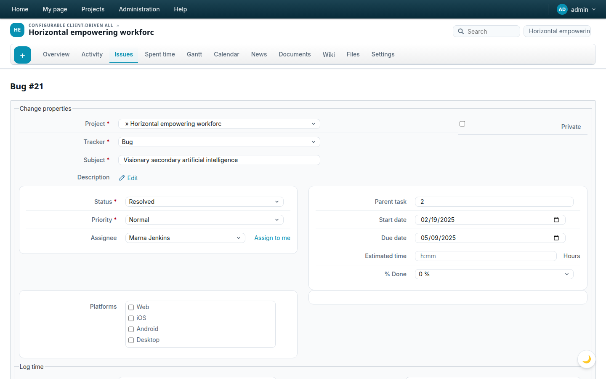 |

| Calendar | My page |
|---|---|
| 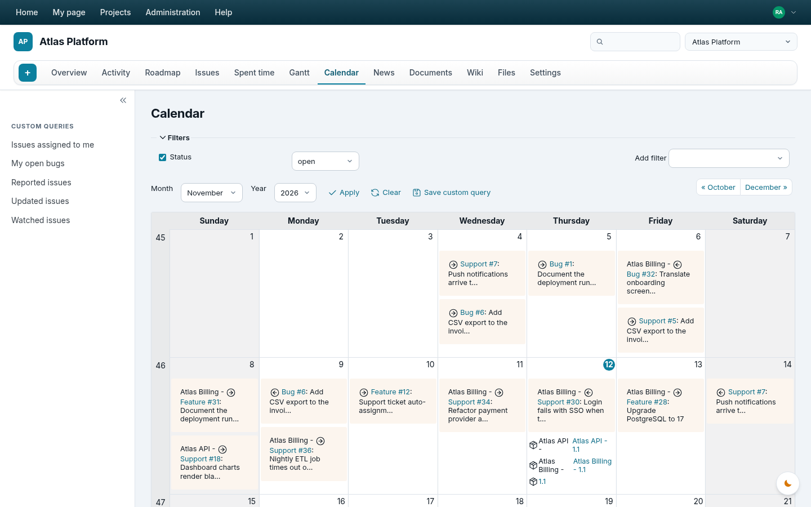 | 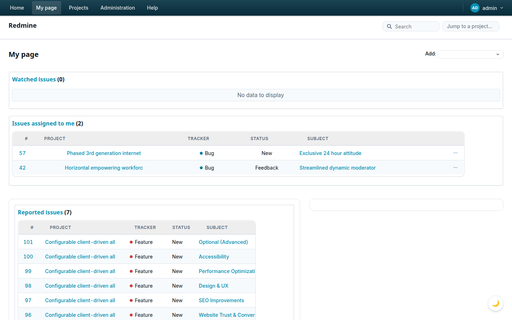 |

**Dark**

| Projects | Project settings |
|---|---|
| 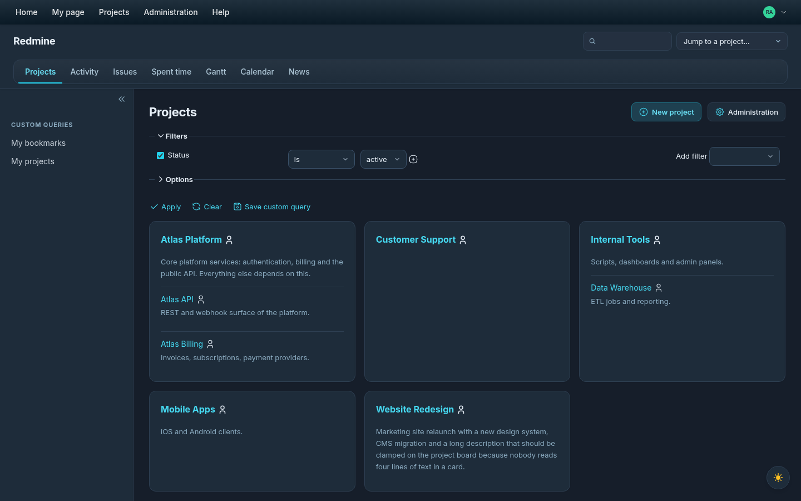 | 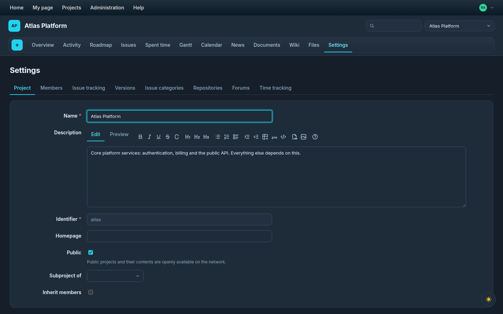 |

| Gantt | Scheme picker on My account |
|---|---|
| 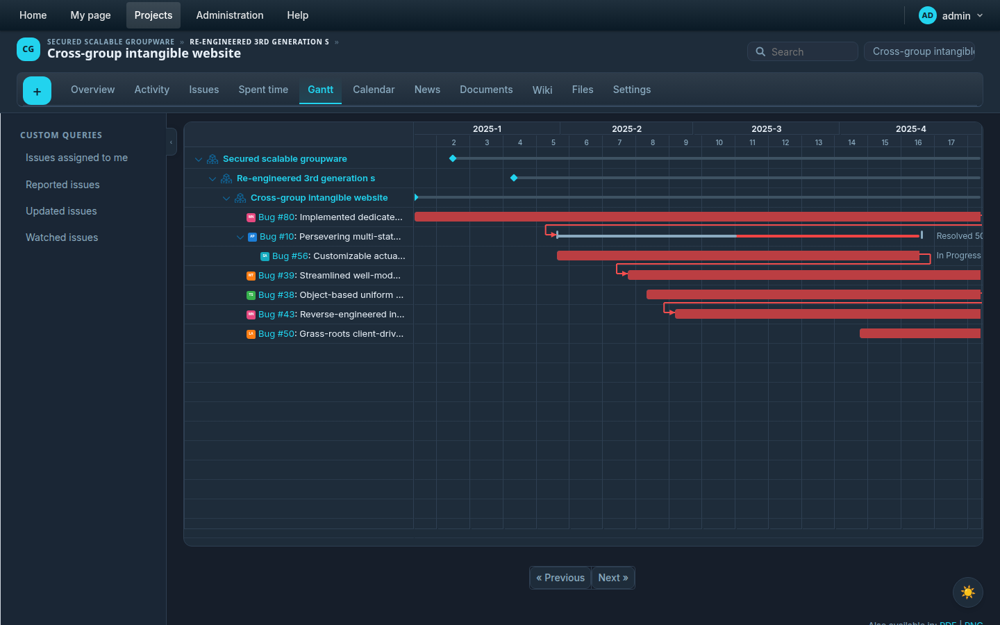 | 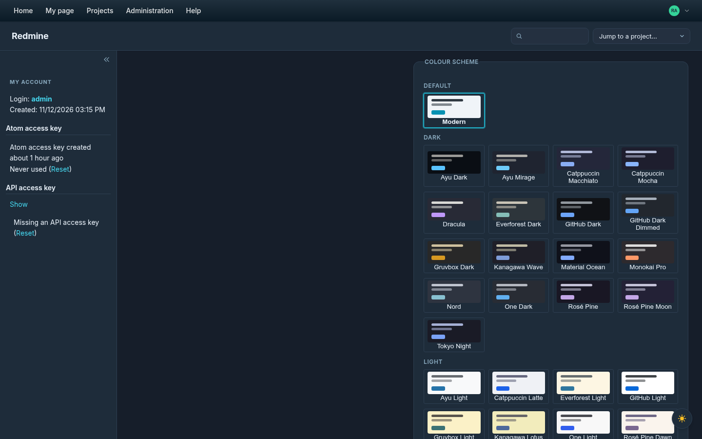 |

**Colour schemes**

| Dracula | Nord |
|---|---|
| 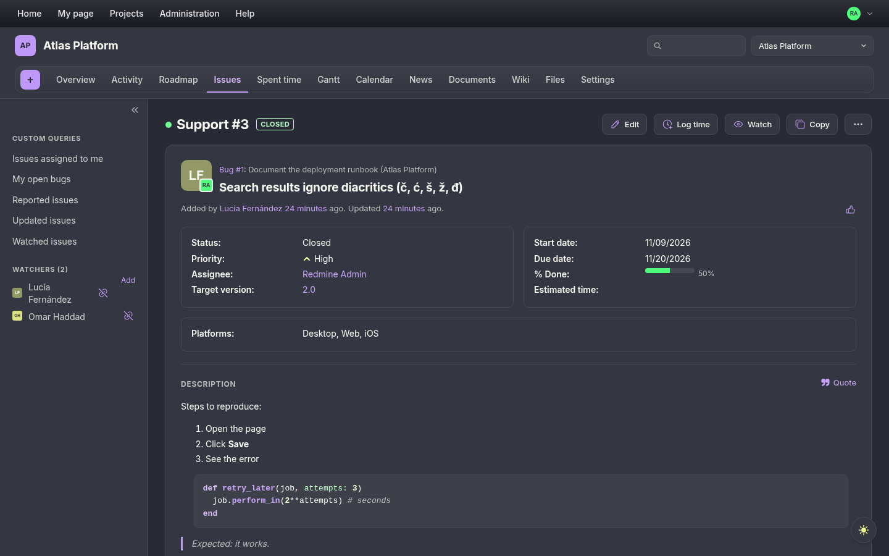 | 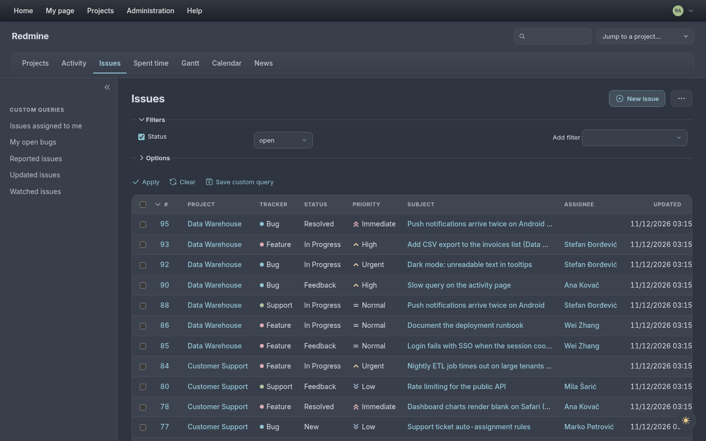 |

| Solarized Light | Gruvbox Light |
|---|---|
| 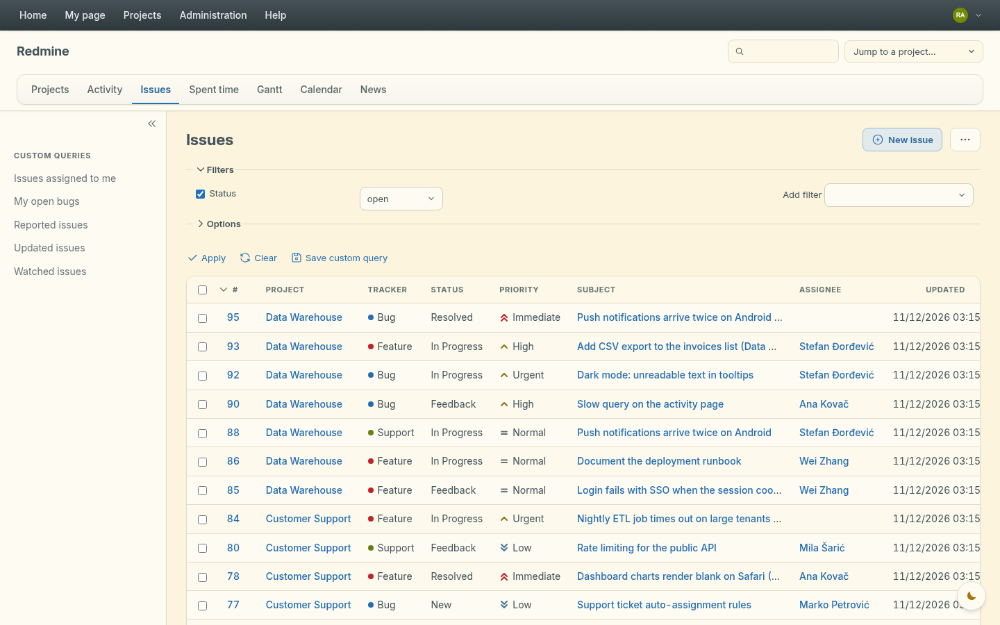 | 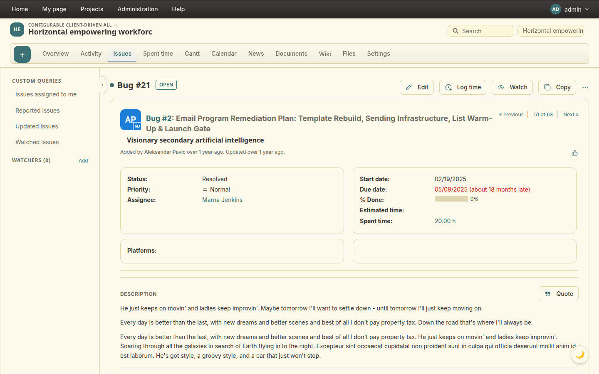 |

The four schemes used last sit in the account menu:

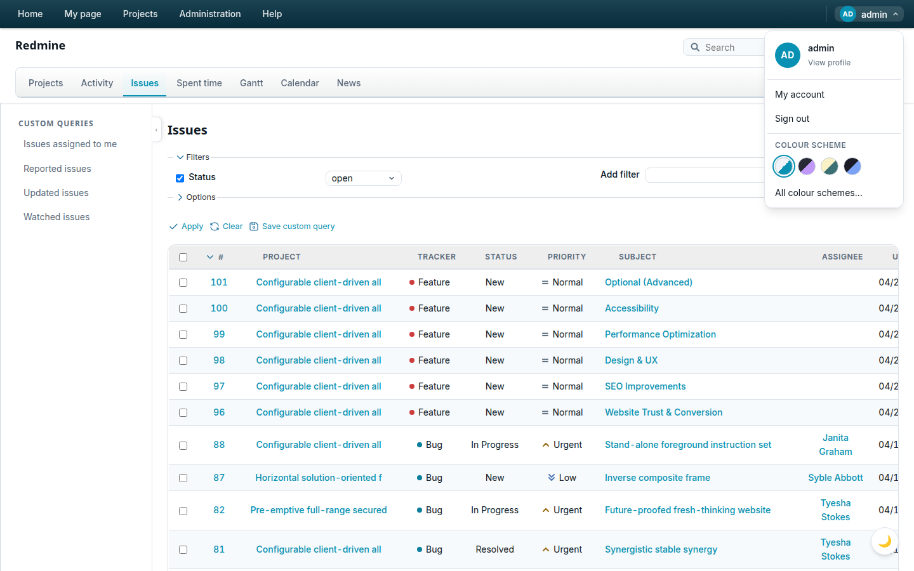

**Phone**

| Issue | Issue list, dark | Menu, dark |
|---|---|---|
| 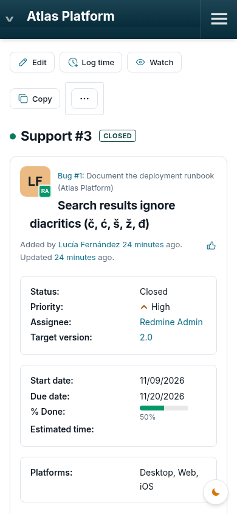 | 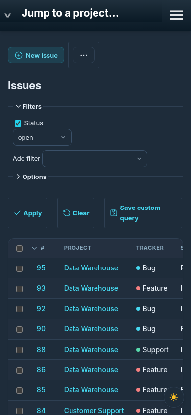 | 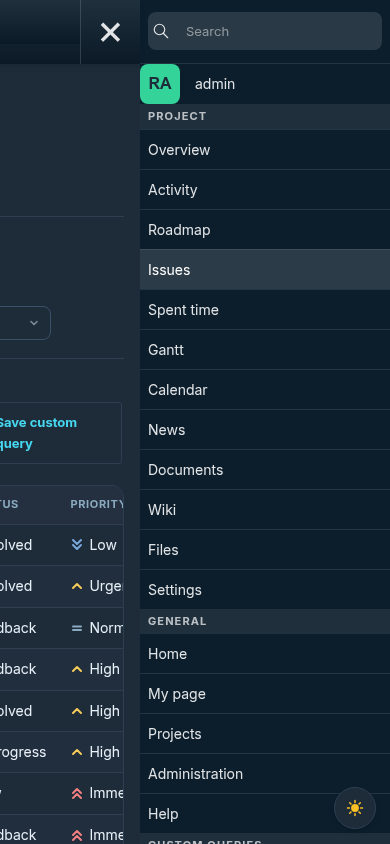 |

## Author

Made by **Aleksandar Pavic**, author of the
[Redmine Cookbook](https://www.packtpub.com/en-us/product/redmine-cookbook-9781785285264)
(Packt Publishing).

## Credits

- Palettes: [Gogh](https://github.com/Gogh-Co/Gogh) (MIT)
- Font: [Inter](https://rsms.me/inter/) (OFL)
- Ideas (no code): priority arrows and tracker dots from Opale, gradient bars from gitmike

## Licence

MIT
